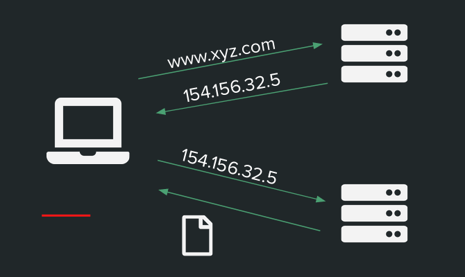
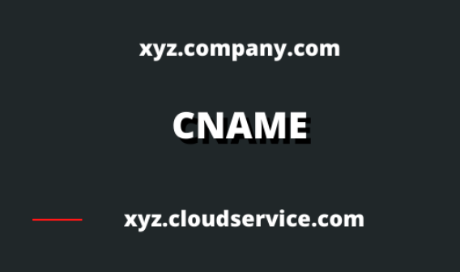
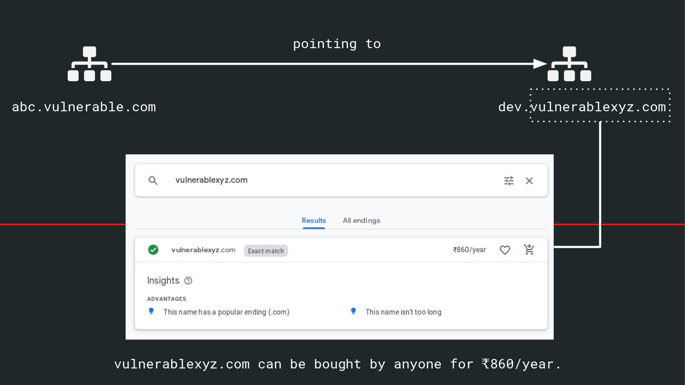

# Subdomain Takeover

A subdomain maps (via DNS) to a third-party service — Azure, AWS, Heroku, GitHub, Fastly, Shopify, etc. — using a CNAME record. If the company cancels the third-party subscription but forgets to remove the DNS record, anyone who claims the target resource on the provider gains full control over that subdomain. Impact is severe: attacker-controlled content on a trusted corporate origin — phishing, cookie/session theft against the parent domain, credential harvesting, and brand damage. Severity is usually High/Critical; it is one of the most reliably paid "free" bug classes.

## Hunting Checklist

1. **Enumerate subdomains** broadly (brute force + cert transparency + passive sources): Assetfinder, Subfinder, Findomain, plus Chaos/CT logs.
2. **Resolve everything and collect CNAME/A targets** — see commands under Test Cases (also in the companion `Easy_Methods.md` one-liner flow).
3. **Keep records that point to known third-party providers** (fingerprint list in `Sub_or_top_level_domain_takeover.md`; canonical list in can-i-take-over-xyz) and note the "safe load / error" status of the provider.
4. **Look for dead-end responses**: 404/"no such app"/"domain is not correctly configured"-class provider errors mean nobody claimed the resource.
5. **Cross-check with takeover scanners** (Subjack, SubOver, subzy, nuclei takeover templates) — then verify manually.
6. **Check the CNAME's target domain itself** for availability: some subdomains point to *purchasable* domains (see Case below).
7. **Prove it**: claim the resource (or register the CNAME domain where in-scope/allowed), host a harmless PoC page referencing the program — never touch real users or data.
8. **Escalate the report**: subdomain takeover also implies wildcard/SSL inheritance and cookie-scope risk on the parent domain (see TLD companion doc).

## Test Cases & Examples

### Basics: DNS & CNAME



- When a web address is accessed (e.g. `www.xyz.com`), a DNS query is performed against a DNS server with the host name.
- The DNS server takes the hostname and resolves it into a numeric IP address.



- A CNAME is an alias of one domain name to another: in the example, `xyz.company.com` is the source domain and `xyz.cloudservice.com` is the canonical name.


- Subdomains map to a specific IP or third-party service (Azure, AWS, Heroku, GitHub, Fastly, Shopify, …) to serve content, via a CNAME record — e.g. `xyz.company.com CNAME xyz.cloudservice.com`.
- For whatever reason the company stops using the service and cancels the subscription, **but forgets to update or remove the CNAME record** in the DNS zone file.
- Since the CNAME is still present in `company.com`'s zone, anyone who registers `xyz.cloudservice.com` has full control over `xyz.company.com` until the record is removed.

### Enumeration & resolution commands

```bash
subfinder -d target.com | tee -a domains.txt
assetfinder --subsidiary target.com >> domains.txt
sort -u domains.txt -o domains.txt

# collect DNS records per host
cat domains.txt | while read d; do echo "== $d"; dig "$d" ANY +noall +answer; done > digs.txt
grep -i CNAME digs.txt
```

```bash
# provider error pages are the smoking gun — browse/HTTP each candidate
curl -skL https://shop.target.com | grep -iE "not found|unavailable|good news|can be taken"
```

### Case: CNAME target available to buy



- Sometimes the CNAME's target domain itself is unregistered and purchasable.
- In that case the attacker buys the domain directly and hosts their content — full takeover of every subdomain pointing at it, no provider claim needed.

## Bypass Techniques

- **Wildcard DNS (`*.target.com`)** records make "not resolved = safe" checks wrong — the wildcard resolves everything, but individual dangling names can still be claimed on the provider; the reverse (wildcard pointed at a provider that lacks the matching wildcard claim) is covered in `Sub_or_top_level_domain_takeover.md`.
- Some providers only validate **one** of domain/CNAME — test `www.` vs apex vs every subdomain label separately.
- CNAME chains several hops deep: follow the whole chain before concluding a hop is "still in use".
- NS-record takeover (`sub-domains` delegated via `NS` to a dead zone) is a related class — check `dig NS` too.

## Tools & Resources

**Enumeration:** [Assetfinder](https://github.com/tomnomnom/assetfinder) · [Subfinder](https://github.com/projectdiscovery/subfinder) · [Findomain](https://github.com/Edu4rdSHL/findomain)

**Takeover checking (concurrent scanners):** [Subjack](https://github.com/haccer/subjack) · [SubOver](https://github.com/Ice3man543/SubOver) · subzy/nuclei (see `Easy_Methods.md`)

**Manual verification:** walk common error pages yourself; for each engine's status and hijack steps use [can-i-take-over-xyz](https://github.com/EdOverflow/can-i-take-over-xyz). If your engine isn't listed — Google is your friend.

**Readings:**
- [How we Hijacked 26+ Subdomains](https://medium.com/@aishwaryakendle/how-we-hijacked-26-subdomains-9c05c94c7049)
- [Subdomain Takeover: Finding Candidates](https://0xpatrik.com/subdomain-takeover-candidates/)
- [Subdomain Takeover: Proof Creation for Bug Bounties](https://0xpatrik.com/takeover-proofs/)
- Talk at NULL / OWASP Bangalore meetup, June 2020: https://www.youtube.com/watch?v=xCunHBH8ZQ4

**Example resolved reports (HackerOne):**
- [subdomain takeover at news-static.semrush.com](https://hackerone.com/reports/294201)
- [Subdomain takeover of resources.hackerone.com](https://hackerone.com/reports/863551)
- [Subdomain takeover at info.hacker.one](https://hackerone.com/reports/202767)
- [Bulgaria - Subdomain takeover of mail.starbucks.bg](https://hackerone.com/reports/736863)
- [Remote code execution by hijacking an unclaimed S3 bucket in Rocket.Chat's installation script](https://hackerone.com/reports/399166)
- [Possible SOP bypass in www.starbucks.com due to insecure crossdomain.xml](https://hackerone.com/reports/244504)

## Report Tips

- State the chain explicitly: `sub.target.com → CNAME dead-provider.example → unclaimed`, plus the provider's own error string proving nobody owns it.
- PoC = a page you control on the claim (logo text, your handle, "TEST ONLY — do not panic") + screenshot; mention you released/deleted the claim afterwards.
- Frame impact with parent-domain cookie scope (`Domain=.target.com` session theft), phishing on a trusted hostname, and any inherited wildcard SSL — that's what upgrades triage from "stale DNS" to High/Critical.

## Authors

[@aish_kendle](https://twitter.com/aish_kendle) · [@thakare_prateek](https://twitter.com/thakare_prateek) · [@klaus](https://twitter.com/klaus_dev)
